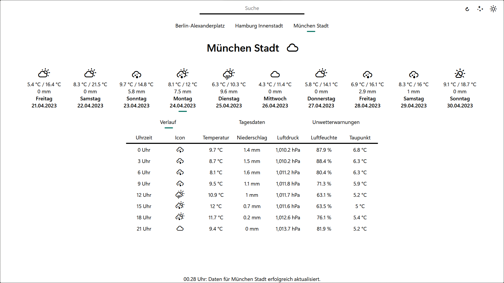

# Wetter

*Wetter* is a web application that can display recent measurements, severe weather warnings and the weather forecast for the upcoming ten days for arbitrary weather stations operated by the German Weather Service (*Deutscher Wetterdienst*/*DWD*).
Enjoy :)

> [!IMPORTANT]
> This app is no longer in active development, has terrible code quality and may break sooner or later.

## Live Demo

https://wetter.dabund24.de

## Usage

Run `app.js` with Node.js and open [localhost:8080](http://localhost:8080) in your browser.

## Resources

### Data

The data displayed in this app is fetched from the API of *WarnWetter-App* by the *DWD*. Learn more about it [here](https://dwd.api.bund.dev/) (unofficial).

### Icons

Learn more about the icons used in this project [here](https://erikflowers.github.io/weather-icons/).

## Screenshot

